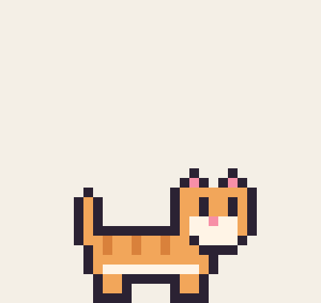

<div align="center">

# 🐱 PranshiOS

**My portfolio is a tiny operating system, and a pixel cat lives on its taskbar.**

### [stryoportfolio.vercel.app](https://stryoportfolio.vercel.app/)



</div>

---

Most portfolios are a scrolling page with a hero, three cards and a contact form. This one boots into a pastel desktop instead. My projects are apps, my resume is a `.txt` file, and there's a terminal that does more than it should.

Down on the taskbar there's a cat. It's the same cat from [desktop-pet](https://github.com/stryo2/desktop-pet), the Electron app that lives on my real Windows taskbar, and this site loads the exact same sprite files. It walks around, naps, grooms itself, and has opinions about whatever you open.

> **In a hurry?** Click 👔 **Recruiter mode** in the taskbar, or go straight to [`/#recruiter`](https://stryoportfolio.vercel.app/#recruiter), for a plain one-page version: projects, experience and skills, no cat. (Well, one very small cat.)

## Things to try

| Do this | What happens |
| --- | --- |
| Open `about.txt` | The cat goes heart-eyed: *"that's my human! 💖"* |
| Open `HexPush.exe` | The cat panics and sneaks off-screen until you close the game. You can play HexPush right inside the window. |
| Open `contact.me` | Confetti. The cat jumps for joy. |
| Click the cat | Purring. If it's asleep, it asks for five more minutes. |
| Open `terminal` and type `help` | `ls`, `open devpulse`, `skills`, `whoami`... |
| Type `sudo hire-pranshi` | Permission granted. ✨ |
| Type `rm -rf /` | The cat sits on the keyboard. Nice try. |
| Click 🐱 in the tray | Swap the cat for a chaotic raccoon 🦝 |
| Click 🌙 | Night mode. The cat doesn't mind. |
| Don't click anything | *"psst… click an icon 👀"* |

Windows drag, focus, minimize and maximize. `Esc` closes the top one. On a phone, the desktop turns into a home screen and windows open full-screen.

## What's inside the apps

| App | What it is |
| --- | --- |
| 📈 **DevPulse** | Developer analytics across GitHub, LeetCode and Codeforces. BullMQ + Redis job queues, idempotent syncs, OAuth. [Live](https://dev-pulse-lake.vercel.app) |
| 💰 **FinDash** | A finance dashboard backend with JWT auth and role-based access control. |
| 🔎 **The Last Stop** | A murder mystery where every suspect is an LLM that knows only its own secrets. [Live](https://ai-murder-mystery-eosin.vercel.app) |
| 🐱 **Desktop Pet** | The cat. It also reminds you to drink water and celebrates your git commits. |
| ⬢ **HexPush** | A 1v1 browser brawler on a shrinking hex arena, built in vanilla JS and canvas. [Play](https://hexpush.netlify.app) |
| 🖼️ **RIDNet** | Deep-learning image denoising with attention modules. |

## How it's built

- **Stack:** React 19, TypeScript and Vite. There's no UI library, animation library or state manager: windows, dragging, the start menu and the cat are all hand-rolled. It's about 86 KB gzipped.

```
src/
├── data/          ← all the content lives here (edit these, not components)
│   ├── profile.ts     name, about, experience, skills
│   └── projects.ts    projects, links, and what the cat says about each one
├── pet/
│   ├── sprites.ts     reads desktop-pet's text-art pet.json files
│   ├── Pet.tsx        the cat's brain: a state machine on requestAnimationFrame
│   ├── bus.ts         tiny event bus so any window can make the cat react
│   └── Confetti.tsx
├── os/
│   ├── Window.tsx     drag, focus, minimize, maximize
│   ├── Taskbar.tsx    start menu, tasks, tray, clock
│   ├── registry.tsx   every app the desktop can open
│   └── useTheme.ts    light/dark, remembered per visitor
├── apps/          ← what's inside each window
└── RecruiterView.tsx
```

### The cat, briefly

The sprites are text art. Each letter is a colour from a palette:

```
"....................",
".............K...K..",
"............KPK.KPK.",
"..K........KOOOOOOOK",
".KOK.......KOOOOOOOK",
```

- **Drawing:** `sprites.ts` turns these rows into pixel grids, stamps a face on top (happy, sleepy, love, surprised...), and draws them on a canvas at 3× with crisp pixels. Walking left is the same sprite, mirrored.
- **Behaviour:** `Pet.tsx` picks the next action by weight (walk, sit, groom, stretch, nap). It blinks at random intervals and listens on the event bus for windows opening and closing.
- **Respecting settings:** if your system has reduced motion turned on, the cat stays put and the confetti stays home.

## Run it locally

```bash
git clone https://github.com/stryo2/portfolio.git
cd portfolio
npm install
npm run dev
```

## Make it yours

1. Edit `src/data/profile.ts` and `src/data/projects.ts`.
2. *(Optional)* Put a PDF at `public/resume.pdf`, and download buttons appear on their own.
3. *(Optional)* Bring your own pet. Any `pet.json` in the desktop-pet format works.

## Say hi

**Pranshi Singh**, backend engineer, IIT Roorkee '27.

[LinkedIn](https://www.linkedin.com/in/pranshi-singh-iitr/) · [GitHub](https://github.com/stryo2) · or open `contact.me` on the [desktop](https://stryoportfolio.vercel.app/) and let the cat celebrate.

<sub>No cats were harmed in the making of this website. One was mildly inconvenienced by HexPush.</sub>
